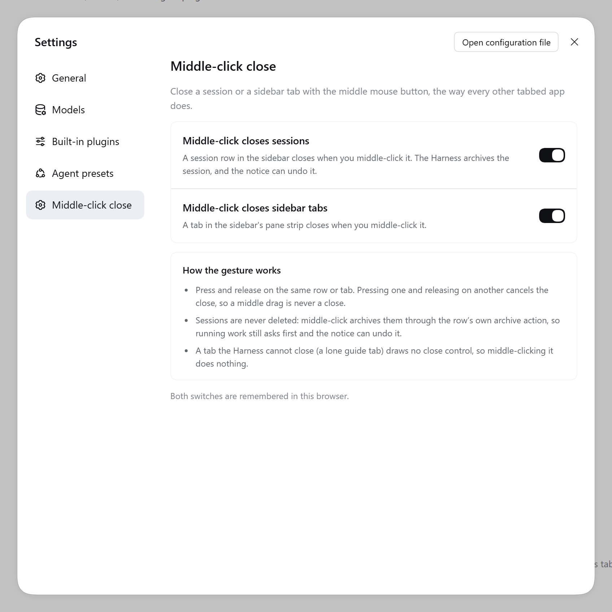
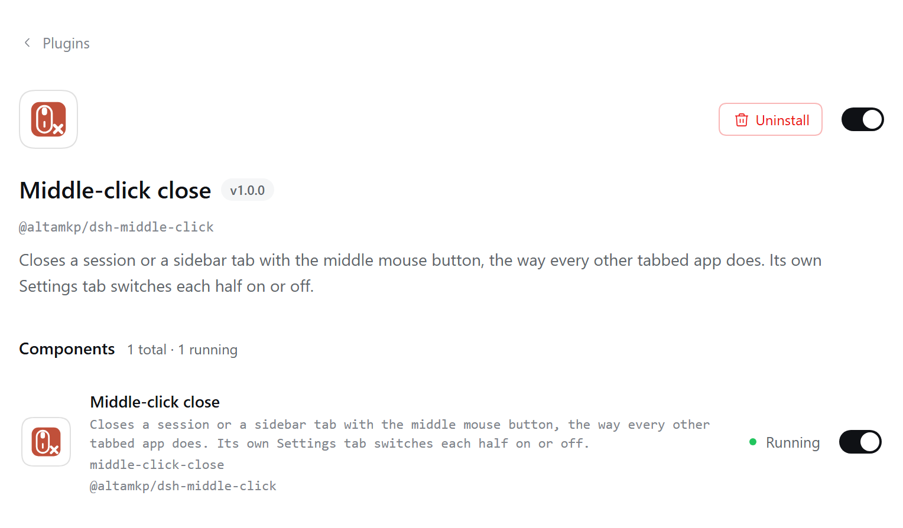

# @altamkp/dsh-middle-click

[English](README.en.md) | 中文

Middle-click closes a session or a sidebar tab in the DeepSeek Harness Web UI, the way every other tabbed app does.

- **Sessions.** Middle-click a session row in the sidebar and the session closes. The Harness archives sessions instead of deleting them, and the plugin triggers the row's **own archive action** — so the confirmation for running work, the stop-and-archive flow and the undo notice are exactly the ones the Harness already renders.
- **Sidebar tabs.** Middle-click a tab in the sidebar's pane strip and it closes through its own close control. A lone guide tab has no close control, so the gesture does nothing there.
- **Its own Settings tab.** **Settings → Middle-click close** holds the two switches, both on by default. The collection version kept them on Settings → General instead.



This is the standalone extraction of the Middle-click close plugin that used to live inside the `@altamkp/dsh-plugin` collection. The current release is 1.0.0. The source lives at <https://github.com/altamkp/dsh-middle-click> (private for now).

## How it works

The gesture is a press **and** a release on the same row or tab. Press one session row and release over another and nothing closes: the release position decides. That is also how the Harness's own tabs behave — pressing one tab and dragging onto another is the Harness's tab move, and a tab captures the pointer while it is pressed, so the release event alone cannot tell a click from a drag. The plugin reads the element under the cursor when the button comes back up and cancels the close unless it is inside the pressed row or tab.

It acts on the Harness's own stable DOM markers, not on CSS class names, so a restyle does not break it:

| Marker | Element |
| --- | --- |
| `data-dockkit-tab` | A tab chip in the sidebar's pane strip |
| `data-dockkit-float-grip` | The header grip of a floating pane |
| `data-row-key="session:…"` | A session row in the sidebar's session tree |

For a tab, the plugin clicks the close control inside the chip. For a session row it clicks the row's archive control, which it finds by the accessible name the Workspace package labels it with; if that control is ever missing from the row, it falls back to the workspace service's `archiveSession` call, which is the same call the button makes. An archived row offers "unarchive" rather than "archive", so middle-clicking it does nothing.

**"Close" means archive.** The Harness never deletes a session: middle-clicking a row runs the archive action the row already offers, so a session with running work still asks first and the undo notice can bring it back. Middle-clicking a tab runs the tab's own close lifecycle, and the Harness's rule that a lone guide tab cannot be closed is untouched.

Everywhere the plugin does not act, the browser's own middle-click behaviour — autoscroll, opening a link in a new tab — is left alone. It is suppressed only on the element the plugin is about to close.

## Settings

The plugin contributes its own page to the Settings navigation — **Middle-click close** in English, **中键关闭** in Chinese — instead of adding rows to Settings → General as the collection version did.

| Switch | Default | What it does |
| --- | --- | --- |
| **Middle-click closes sessions** | on | A middle click on a session row in the sidebar closes (archives) it. Off: the gesture does nothing on session rows. |
| **Middle-click closes sidebar tabs** | on | A middle click on a tab in the sidebar's pane strip closes it; the same switch also covers a floating pane's header. Off: those gestures do nothing. |

Below the switches the tab carries a short **How the gesture works** note — press and release on the same element, archive rather than delete, the lone guide tab that cannot be closed — and the footnote that both switches are remembered in this browser.

The two preferences live in the browser's `localStorage`:

| Preference | Key | Values |
| --- | --- | --- |
| Sessions | `dsh.plugin.middleClickClose.sessions` | `"1"` on, `"0"` off |
| Sidebar tabs | `dsh.plugin.middleClickClose.tabs` | `"1"` on, `"0"` off |

A key that was never written reads as **on**. The keys are the ones the collection version used, so an existing user keeps the choices they made.

They are stored per browser and are not synced through the Host: the switch describes one browser's mouse, and two machines that open the same Host share their sessions but keep their own gesture switches. The gesture is installed as soon as the page loads and does not wait for the Settings tab to be opened — the tab itself mounts only while it is selected.

## Install

Add the package to your profile's `package.json` — once as a dependency, once in the bundle selection:

```json
{
  "dsh": {
    "profile": {
      "bundles": ["@altamkp/dsh-middle-click"]
    }
  },
  "dependencies": {
    "@altamkp/dsh-middle-click": "github:altamkp/dsh-middle-click"
  }
}
```

You can also install it through the Harness plugin manager: **Install bundle** → the path to this directory. Then restart the Harness, or toggle the bundle off and on in the plugin manager; **Settings → Middle-click close** appears after that.



The bundle ships one row:

```yaml
- insert:
    - id: middle-click-close
      name: '@altamkp/dsh-middle-click'
```

While working on the plugin itself, `link:` keeps the installed copy in step with your working tree instead of a published one:

```json
{
  "dependencies": {
    "@altamkp/dsh-middle-click": "link:/path/to/dsh-middle-click"
  }
}
```

The `github:` spec above needs an account with access to the repository, which is private at the moment.

## Requirements and compatibility

- DeepSeek Harness 0.2.1-rc.2 or newer, and the Web UI. There is no terminal or CLI side — everything the plugin does happens in the page.
- A mouse with a middle button.
- Locales shipped: English and Simplified Chinese. The Settings tab, its navigation entry, and the plugin's name and description in the plugin manager follow the app's language.

The Host half (`index.js`) is deliberately a no-op. It exists so the package has its row, and the row is what makes the browser half part of the Web module roster; it contributes no host behaviour of its own.

## Migration from the collection

The Middle-click close plugin used to live inside the `@altamkp/dsh-plugin`
collection. **Collection v2.8.0 removed it** — the row, the browser half and
the locale files are gone from that bundle — so a profile on v2.8.0 or newer
carries the plugin exactly once, and there is no second copy to disable.

A profile still pinned to an older collection release carries both: the
collection's own row and this package's row, and one middle click is processed
by both copies. Update the collection — reinstall the bundle in the plugin
manager, or `pnpm update @altamkp/dsh-plugin` in the profile directory — so it
resolves to v2.8.0, and the duplicate is gone.

What changes and what does not:

- **The switches carry over.** The `localStorage` keys are unchanged, so the settings you had are the settings you get.
- **The entry point moves.** The rows in Settings → General are gone; the same two switches are now the **Middle-click close** page in the Settings navigation.
- **The plugin manager gets its own item.** The bundle now carries its own name, description and icon instead of a row inside the collection.

## Layout

```
dsh-middle-click/
├── index.js              the Host half: a no-op
├── client.js             the Web page half: the gesture and the Settings tab
├── cordis.patch.yml      the bundle patch: one row
├── package.json          the exports, and the `dsh` block that declares the Web client
├── locale/
│   ├── en.json           the plugin's name and description
│   └── zh.json
├── icon.svg              the icon the plugin manager shows
├── docs/                 the screenshots in this README
└── LICENSE               MIT
```

## License

MIT — see [LICENSE](LICENSE).
