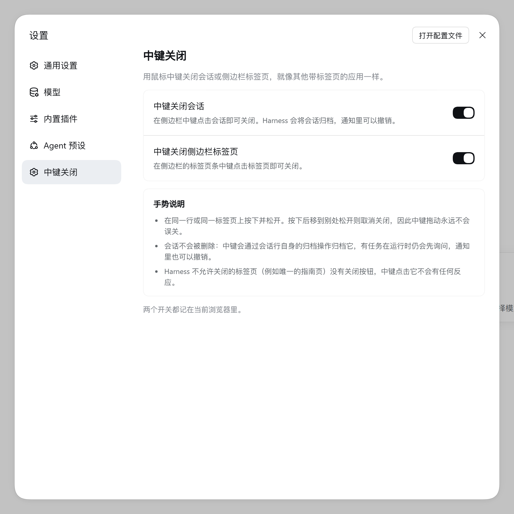
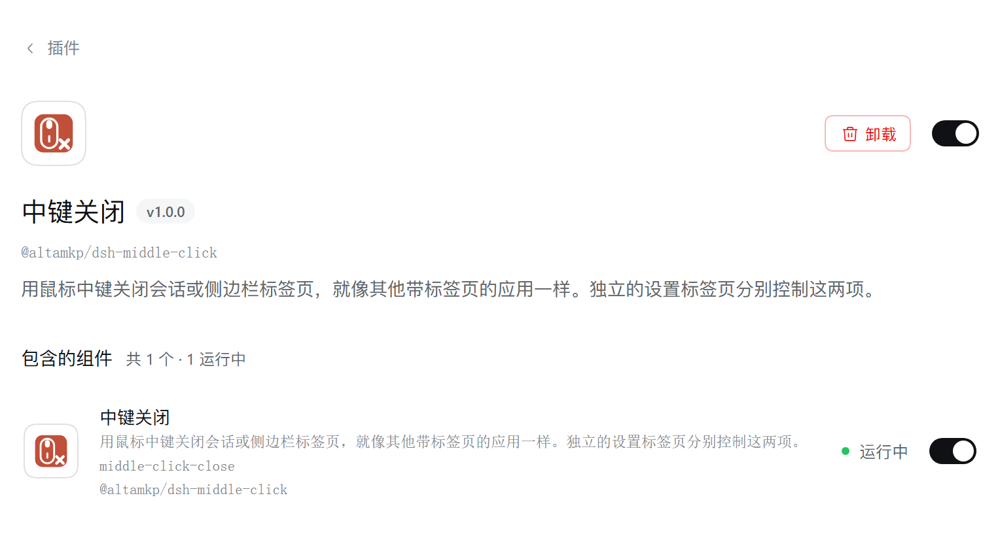

# @altamkp/dsh-middle-click

[English](README.md) | 中文

在 DeepSeek Harness 的 Web 界面里，用鼠标中键关闭会话或侧边栏标签页——和其他带标签页的应用一样。

- **会话**：在侧边栏的会话行上按中键，会话即被关闭。Harness 从不删除会话，只做归档，所以插件触发的是这一行**自带的归档操作**：有任务在运行时该弹的确认框、停止并归档的流程、以及带撤销的通知，都还是 Harness 原来那套。
- **侧边栏标签页**：在侧边栏的标签条上中键点击标签页，插件触发它自带的关闭按钮。唯一的指南页没有关闭按钮，中键点它不会有任何反应。
- **独立的设置页**：设置 → **中键关闭** 里放着两个开关，默认都打开。合集版本里，这两项在 设置 → 通用。



这个仓库是把原本放在 `@altamkp/dsh-plugin` 合集里的「中键关闭」插件单独抽出来的版本，版本号 1.0.0。源码在 <https://github.com/altamkp/dsh-middle-click>（目前是私有仓库）。

## 工作原理

手势是「在同一行、同一标签页上按下，再在同一处松开」。在某个会话行上按下、移到别处才松开，不会关闭任何东西——决定要不要关的是松手的位置。这一点也跟 Harness 自己的标签页行为一致：按住一个标签页拖到另一个上面，那是它在移动标签页；而且标签页被按住期间会捕获指针，光看松开事件本身分不清点击和拖动。插件在按键松开时读出光标下的元素，只有它还落在按下的那一行/标签页内部，才真的执行关闭。

插件认的是 Harness 稳定的 DOM 标记，不看 CSS 类名，所以换一套样式不会影响它：

| 标记 | 对应的元素 |
| --- | --- |
| `data-dockkit-tab` | 侧边栏标签条上的标签页 |
| `data-dockkit-float-grip` | 浮动面板的标题栏 |
| `data-row-key="session:…"` | 侧边栏会话树里的一行会话 |

对标签页，插件点击标签页里的关闭控件；对会话行，它按 Workspace 包给归档按钮的可访问名称找到按钮再点击；万一这一行上找不到该控件，就退回到 workspace 服务的 `archiveSession`，也就是那个按钮自己会调的方法。已归档的行给出的是「取消归档」而不是「归档」，所以中键点它没有反应。

**这里的「关闭」就是归档。** Harness 不删除会话：中键点击会话行，走的就是这一行本来就有的归档操作，所以有任务在运行时仍然会先问一句，通知里的撤销也能把它恢复。中键点击标签页，走的是标签页自己的关闭流程，「唯一的指南页不能关」这条规则完全不受影响。

插件不处理的地方，浏览器自己的中键行为（自动滚动、在新标签页打开链接）原样保留；只有在它准备关闭的那个元素上才会被拦掉。

## 设置

插件在设置的导航里注册自己的一页——中文叫 **中键关闭**，英文是 **Middle-click close**——而不是像合集版那样往 设置 → 通用 里加两行。

| 开关 | 默认 | 作用 |
| --- | --- | --- |
| **中键关闭会话** | 开 | 中键点击侧边栏的会话行即关闭（归档）。关掉后，会话行上的中键手势没有反应。 |
| **中键关闭侧边栏标签页** | 开 | 中键点击侧边栏标签条上的标签页即关闭；浮动面板的标题栏也归这个开关管。关掉后，这些手势都没有反应。 |

开关下面是一段简短的「手势说明」——按下和松开要在同一处、关闭是归档不是删除、唯一的指南页关不掉——页脚则注明两个开关都记在当前浏览器里。

两个开关存在浏览器的 `localStorage` 里：

| 偏好 | 键 | 值 |
| --- | --- | --- |
| 会话 | `dsh.plugin.middleClickClose.sessions` | `"1"` 开，`"0"` 关 |
| 侧边栏标签页 | `dsh.plugin.middleClickClose.tabs` | `"1"` 开，`"0"` 关 |

没写过的键按**开**处理。键名和合集版本保持一致，所以从合集升级上来的用户，之前的选择还在。

这些偏好只属于当前这台浏览器，不会同步到 Host：它们描述的只是某一台机器的鼠标，同一个 Host 上的两台电脑共享会话，但各自保留自己的开关。手势在页面加载时就装好了，不用先打开设置页；设置页本身只在被选中时才挂载。

## 安装

把这个包加进 profile 的 `package.json`，依赖和 bundle 选择各写一处：

```json
{
  "dsh": {
    "profile": {
      "bundles": ["@altamkp/dsh-middle-click"]
    }
  },
  "dependencies": {
    "@altamkp/dsh-middle-click": "github:altamkp/dsh-middle-click"
  }
}
```

也可以用 Harness 的插件管理器安装：**Install bundle** → 选这个目录。装好后重启 Harness，或者在插件管理器里把 bundle 关掉再打开，**设置 → 中键关闭** 就会出现。



它带的 bundle patch 只有一行：

```yaml
- insert:
    - id: middle-click-close
      name: '@altamkp/dsh-middle-click'
```

还在改插件本身的时候，用 `link:` 可以让装好的副本直接跟着工作目录走，而不用发布：

```json
{
  "dependencies": {
    "@altamkp/dsh-middle-click": "link:/path/to/dsh-middle-click"
  }
}
```

上面的 `github:` 写法需要有仓库权限的账号——这个仓库目前还是私有的。

## 环境与兼容性

- DeepSeek Harness 0.2.1-rc.2 或更新版本，并且使用 Web 界面。没有命令行那一侧：插件做的事情全都在页面里。
- 一个带中键的鼠标。
- 自带英文和简体中文两种语言。设置页、它在导航里的名字、以及插件管理器里的名称和描述，都跟随应用当前的语言。

Host 那一半（`index.js`）是空的。它存在的意义是让这个包有一行插件记录，而正是这一行让浏览器那一半进入 Web 模块名单；它本身不提供任何 Host 行为。

## 从合集迁移

「中键关闭」原本住在 `@altamkp/dsh-plugin` 合集里。**合集 v2.8.0 已经把它移除**——那一行、浏览器那一半和 locale 文件都不在合集里了——所以用 v2.8.0 及更新版本的 profile 里，这个插件只有一份，不需要再关掉第二份。

还停在旧合集版本上的 profile 则会有两份：合集里的一行和这个包的一行，一次中键会被两份代码各处理一次。把合集更新到 v2.8.0（在插件管理器里重新安装这个 bundle，或在 profile 目录里执行 `pnpm update @altamkp/dsh-plugin`），重复的那一份就没有了。

变与不变：

- **开关保留。** `localStorage` 的键名没变，原来的选择还是原来的选择。
- **入口换了。** 设置 → 通用 里的两行没有了，同样两个开关现在是设置导航里的「中键关闭」一页。
- **插件管理器里成了独立一项。** 这个 bundle 有自己的名称、描述和图标，不再是合集里的一行。

## 目录结构

```
dsh-middle-click/
├── index.js              Host 那一半：空的
├── client.js             Web 页面那一半：手势和设置页
├── cordis.patch.yml      bundle patch：只有一行
├── package.json          导出，以及声明 Web 客户端的 `dsh` 段
├── locale/
│   ├── en.json           插件的名称和描述
│   └── zh.json
├── icon.svg              插件管理器里显示的图标
├── docs/                 本文里的截图
└── LICENSE               MIT
```

## 许可证

MIT——见 [LICENSE](LICENSE)。
